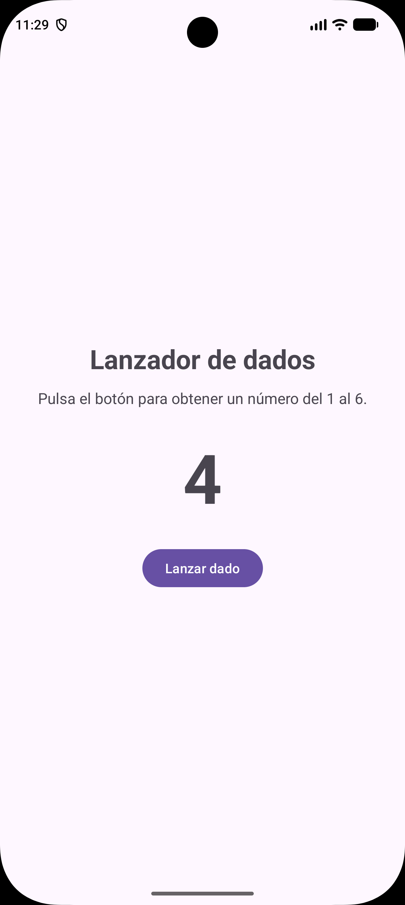

# Lanzador de dados

## ¿Qué hace la aplicación?

La aplicación simula el lanzamiento de un dado de seis caras. Al pulsar el botón **Lanzar dado**, genera un número aleatorio entre **1 y 6**, ambos incluidos, y lo muestra en pantalla.

Se puede pulsar el botón tantas veces como se quiera. Un resultado puede repetirse en lanzamientos consecutivos, igual que con un dado real.

## Tecnologías utilizadas

- **Kotlin**
- **XML**
- **Android Studio**

## Captura de pantalla

